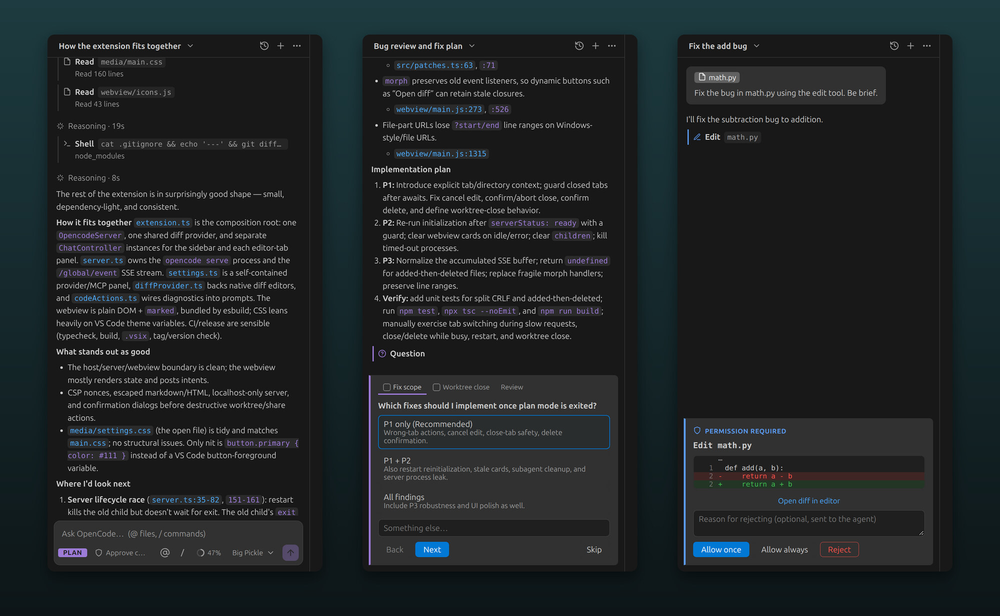
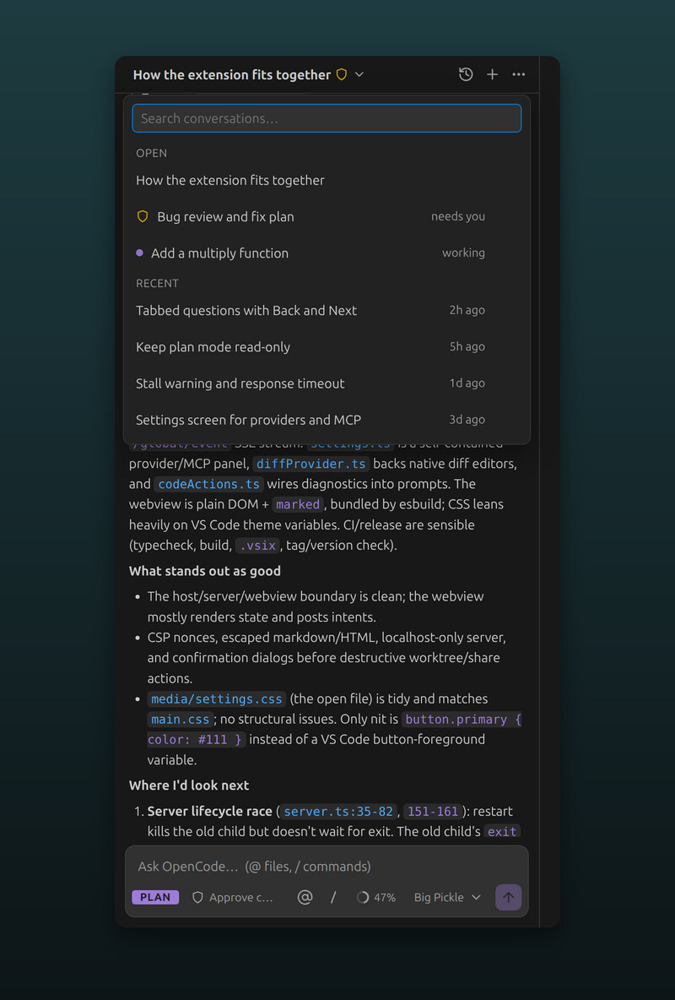

# Chat for OpenCode

[](https://github.com/marc-cr1810/chat-for-opencode/actions/workflows/ci.yml)

An unofficial VS Code chat panel for [OpenCode](https://opencode.ai).

> Not affiliated with, endorsed by or sponsored by OpenCode or its authors. "OpenCode" is used only to
> say which tool this extension works with. For OpenCode's own extension, see
> [opencode.ai](https://opencode.ai).

It starts `opencode serve` in your workspace and talks to it over its local HTTP API, so it uses
whatever providers, models, agents and commands you've configured for the opencode CLI.



## Features

- Chat in an editor tab (button in the editor title bar) or in the secondary side bar (right-hand side, next to other chat extensions)
- Streaming responses, collapsible reasoning, tool calls with per-tool icons (Read / Edit / Shell …)
- Inline diffs for edits, plus "Open diff" in VS Code's native diff editor
- Permission prompts: **Allow once / Allow always / Reject** with an optional reason (Enter / Esc)
- Agent switcher (build, plan and your custom agents) cycled with **Tab**, plus an approve / auto-approve edits toggle
- Current file / selection shared automatically (eye toggle in the footer)
- `@` file mentions with autocomplete, `@file#L10-20` line ranges, pasted images
- `/` commands: built-ins (`/new`, `/compact`, `/model`, `/history`) plus your OpenCode commands
- Model picker, past conversations (search, resume, delete), task list, Esc to interrupt
- **Undo to here** on any of your messages: rolls the conversation back and restores the files OpenCode changed (with Redo)
- **Changes panel** listing every file the session changed, with +/- counts, native diff view and per-file discard
- **Context meter** showing how full the model's context is and what the session has cost; click to compact
- **Background conversations**: one conversation shows at a time, with a dropdown to switch. A conversation that is still running or waiting for approval keeps going when you switch away; the dropdown lists it under Open, and the title shows when one needs you
- **Edit and resend** any earlier message (undoes from that point, then sends the edited text)
- **Subagent view**: steps run by `explore` / `general` subagents stream in, nested under the task
- **Worktrees**: start a conversation in an isolated git worktree, then apply its changes to your workspace or throw them away
- **Share links** for a conversation (asks first, since the link is public)
- **Clickable file references** like `src/app.ts:42` in replies
- **Fix / Explain with OpenCode** in the lightbulb menu for errors and warnings
- **Right-click menu** in the editor: Explain, Refactor, Write Tests, Add Selection to Prompt
- **Status bar item** showing the agent and model, a spinner while working, and a warning when approval is needed
- **Notifications** when a task finishes or needs approval while the panel is hidden (`opencodeChat.notifications`)
- **Settings screen** (`…` → Providers and MCP servers) to add API keys, connect or add MCP servers, and open config files
- Questions asked by the agent rendered as option cards, tabbed with Back / Next and a review step when there are several
- **Stall warning**: when the model goes quiet (not counting running tools), the status line says so, with Stop and Retry. An optional timeout stops it for you
- **Rate limits**: when OpenCode is waiting to retry (a rate limit, an overloaded provider, Zen's free limit), the status line says why and when it tries again, instead of looking stalled



## Keybindings

| Key | Action |
| --- | --- |
| `Ctrl+Alt+O` | Open / focus the chat |
| `Ctrl+Alt+Shift+O` | Open the chat in an editor tab |
| `Ctrl+Alt+K` | Add the current selection to the prompt |
| `Tab` (in input) | Switch agent |
| `Esc` | Stop |

## Settings

Versions before 0.5 used `opencode.*` setting names, which clashed with OpenCode's own extension. Any you
set are copied to the new names on first start.

- `opencodeChat.binaryPath` – path to `opencode` (default: `opencode` on PATH)
- `opencodeChat.autoApproveEdits` – apply edits without asking (shell commands always ask)
- `opencodeChat.autoApproveReadOnly` – in plan (and other read-only agents), run read-only shell commands like `ls`, `grep` and `git log` without asking; redirects and write/exec flags still ask
- `opencodeChat.model` – default `provider/model`
- `opencodeChat.defaultAgent` – agent new conversations start in, e.g. `plan` (default: OpenCode's)
- `opencodeChat.sendKey` – `enter` (default) or `ctrlEnter`, where Enter adds a new line
- `opencodeChat.includeSelection` – share the current file and selection by default (default on)
- `opencodeChat.reasoning` – reasoning starts `collapsed` (default) or `expanded`
- `opencodeChat.toolOutput` – which tool steps start open: `auto` (diffs and to-dos, default), `expanded` or `collapsed`
- `opencodeChat.notifications` – notify when a task finishes or needs approval while no visible panel shows it (default on)
- `opencodeChat.notifyWhenFinished` – also notify when a task finishes, not only for approvals (default on)
- `opencodeChat.contextWarningPercent` – when the context meter turns amber and suggests compacting (default 75)
- `opencodeChat.stallWarningSeconds` – warn after this long without a response from the model; 0 turns it off (default 30)
- `opencodeChat.responseTimeoutSeconds` – stop the request after this long without a response; 0 turns it off (default 0)
- `opencodeChat.preferredLocation` – `sidebar` (default, the secondary side bar) | `panel` (editor tab)

## Build

```bash
npm install
npm run package   # produces chat-for-opencode-<version>.vsix
code --install-extension chat-for-opencode-<version>.vsix
```

For development, open this folder in VS Code and press F5.

```bash
npm test          # unit tests (event-stream parsing, change reconstruction)
npm run typecheck
```

## Releasing

CI typechecks, tests, builds and packages every push and pull request (the `.vsix` is attached to the run as an artifact).

To publish a release, bump the version and push the tag:

```bash
npm version patch
git push --follow-tags
```

The release workflow checks that the tag matches `package.json`, builds the `.vsix` and attaches it to a
GitHub release with generated notes. To also publish to the VS Code Marketplace or Open VSX, set a real
`publisher` in `package.json` and add a `VSCE_PAT` or `OVSX_PAT` repository secret.

## License

MIT. Third-party code and icons are listed in [THIRD_PARTY_NOTICES.md](THIRD_PARTY_NOTICES.md).
